# Архитектура — предложение для согласования

Flutter с платформенными адаптерами принят основателем 26 ноября 2026.
Ниже сохранено сравнение, на основании которого сделан выбор. Критерии: локальная модель, доступ к iOS,
дальнейший Android, живая графика и сопровождаемость небольшим проектом.

| Вариант | Локальная модель и iOS | Android | Графика и поддержка | Оценка |
| --- | --- | --- | --- | --- |
| Flutter / Dart + платформенные адаптеры | Core ML через Swift или ONNX через проверенный адаптер; требуется прототип интеграции | Общий UI и доменная логика, отдельные системные адаптеры | Подходит для 2D-сцен/шейдеров; сложную 3D-руку нужно отдельно проверить | Рекомендуемый кандидат |
| Swift / SwiftUI + выделенные контракты ядра | Прямой доступ к Core ML, Speech, аудио и профилированию | UI и часть интеграций придётся реализовать заново; переносимы спецификации/тестовые случаи | Удобен для проверки iPhone, выше цена второй платформы | Резервный iOS-first путь при проблемах Flutter |
| React Native / TypeScript | Нативные модули для модели/аудио; окружение общего предпросмотра не гарантирует их работу | Общая логика и часть UI | Для графики и высокочастотных эффектов нужны дополнительные компоненты | Возможен, но преимуществ для этого ядра пока не доказано |
| Unity / C# | Модель и системные сервисы требуют подходящих плагинов | Единая сцена для двух платформ | Силен в 3D; риск размера, батареи, сложности обычного UI и лицензирования | Не базовый выбор до измерений |

Рекомендация: Flutter для оболочки и общих сценариев, тонкие Swift/Kotlin-адаптеры
для локального inference, микрофона/распознавания, часов, защищённого хранения,
уведомлений и haptics. Python — только исследование и обучение на рабочей машине.
Формат модели выбрать после проверки экспорта и измерений; ONNX/Core ML пока
кандидаты. Не обещать одинаковую производительность на двух платформах.

## Границы будущих модулей

| Модуль | Ответственность и ограничения |
| --- | --- |
| Onboarding / preferences / consent | Три слайда, локальные имя и настройки; два независимых выбора 4×4; версия согласия |
| Input / speech / amplitude | Ручной ввод, редактирование, явное подтверждение; локальная речь либо ручной ввод; фактический уровень микрофона |
| Normalization / validation | Сохранить смысл и отрицания; риск, форма и собственное действие; полный контекст, без обрезки ради допуска |
| Policy gate | Только подтверждённая актуальная редакция, совместимая проверенная модель и ALLOW; ошибки закрывают доступ |
| RNG | Системный CSPRNG, целое 0–99, 0–49 ДА / 50–99 НЕТ; нет текста, истории и настройки стиля на входе |
| Session / timer / notifications | Атомарность, повторные нажатия, восстановление, 1800 секунд после показа; уведомление не источник истины |
| Scenes / effects / audio / haptics | Показывают уже определённый результат, не влияют на него; reduced motion, пауза в фоне |
| Localization / accessibility / help | RU/EN, диктор, масштаб текста, офлайн-помощь и выбор страны |
| Statistics / API | Отдельное добровольное согласие; только разрешённые агрегаты, без текста/аудио/имени |
| Errors / integrity / tests | Версии модели/токенизатора/правил; закрытый отказ, приватные диагностические коды |

В `bench` находится исследовательский контракт; в мобильном стенде этапа 2 работает локальная ONNX-модель с закрытым допуском. На этапе 3 добавлены отдельное Dart-ядро `QuestionSession` и адаптер `ClosedModelGate`, который не может вернуть разрешение для реального вопроса. Экран и нативные адаптеры хранилища, часов и уведомлений подключены; фактические результаты сборки и нативных испытаний записаны в PROJECT_STATUS.md. [Фактическая схема, результаты и оставшаяся работа](STAGE_3.md).

## Предлагаемая последовательность состояний

```mermaid
stateDiagram-v2
    [*] --> Idle
    Idle --> Recording: локальное разрешение микрофона
    Idle --> Editing: ручной ввод
    Recording --> Editing: завершение записи
    Recording --> Idle: отмена
    Editing --> Checking: явное подтверждение редакции
    Checking --> Rejected: риск / неясность / неверная форма
    Checking --> Failure: ошибка или недоступная модель
    Checking --> Available: ALLOW актуальной редакции
    Available --> Cooldown: попытка ещё недоступна
    Available --> Pending: попытка доступна; один результат
    Pending --> Showing: сохранение минимальной транзакции и анимация
    Showing --> Cooldown: успешный показ; 1800 секунд
    Cooldown --> Idle: срок истёк
    Rejected --> Editing: новое подтверждение после изменения
    Failure --> Editing: повторная проверка после устранения ошибки
```

Это общая продуктовая схема; голос и сцены относятся к последующим этапам. Ядро этапа 3 уже инвалидирует проверку при изменении редакции, защищает от повторного нажатия и сохраняет ответ до показа. Основатель утвердил восстановление того же ответа без нового RNG и начало 1800 секунд после показа. Состояния записи: `idle → reserved → pending(answer) → cooldown(deadlines, bootToken) → idle`. Неоднозначная запись блокирует текущую сессию; восстановление читает фактическое состояние без автоматического RNG. `reserved` без сохранённого ответа требует явного закрытия сообщения о прерывании.

Запись на диск и кадр экрана не атомарны: при сбое фиксации показа возможен повторный показ того же ответа и полная пауза. Текст и аудио не входят в запись; ответ удаляется при переходе в `cooldown`. Контроллер рассчитан на одного владельца записи. Одно уведомление заменяется по фиксированному ID, его отказ не меняет таймер. Ядро и интерфейс проверены на тестовых адаптерах. Swift-адаптер использует приватный каталог без backup, синхронизированный staging-файл и атомарный rename, mach_continuous_time и частный POSIX-маркер с безопасной фиксацией до создания; при запрете API — документированный KERN_BOOTTIME (границы описаны в STAGE_3_RESILIENCE.md), UNUserNotificationCenter. Реальная и диагностическая области хранилища и ID уведомлений разделены. Системные ответы уведомлений имеют сроки ожидания; неизвестный исход добавления временно блокирует новые добавления до отмены позднего запроса. Системные разрешения и доставка на физическом iPhone требуют отдельного испытания новой версии; оно отложено по просьбе основателя.

## Приватность и пределы

Основной путь не использует сеть. Локальный отказ не заменяется облачным запросом.
Вопрос существует временно в памяти; Python-стенд не гарантирует физическое
затирание памяти и не моделирует мобильные crash reports/backup. Это проверяется
на реальном приложении. Вопросы и ответы не превращаются в журнал.

Нельзя обещать защиту локального таймера от любого изменения часов, переустановки
или модифицированного устройства. Не вводить серверную идентификацию для решения
этой задачи. Не внедрять статистику, графику или RNG раньше соответствующих этапов.
